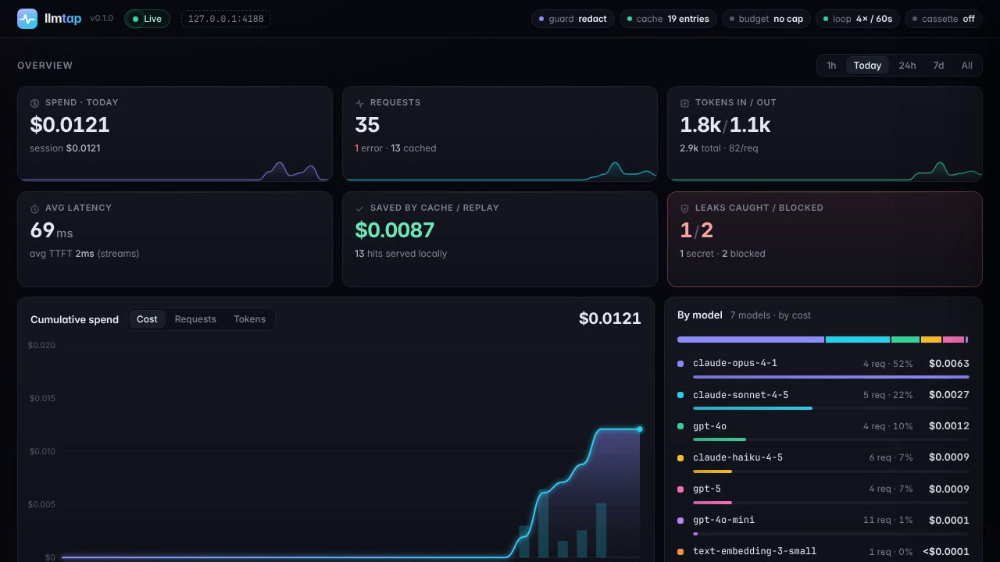

<div align="center">


### The flight recorder & firewall for LLM apps.

**One command. Zero code changes. Zero dependencies.**<br>
See every LLM call live, know exactly what it cost, replay it in CI for free, and stop secrets and runaway agents before they hit the API.

[](https://www.python.org/)
[](pyproject.toml)
[](LICENSE)
[](CONTRIBUTING.md)

[30-second start](#-30-second-start) ·
[Features](#-features) ·
[Cassettes for CI](#-recordreplay-cassettes-vcr-for-llms) ·
[Guard](#-secret-guard) ·
[CLI](#-cli-cheatsheet) ·
[How it works](#-how-it-works) ·
[Comparison](#-how-does-it-compare) ·
[FAQ](#-faq)

</div>

```bash
llmtap wrap -- python my_agent.py
```

That's the whole integration. llmtap starts a local proxy, points your app's LLM SDKs at it through
environment variables, runs your command, and prints what happened when it exits: every request, every token,
every cent.

---

## ⚡ 30-second start

```bash
pipx install git+https://github.com/AshishAgrawal101/llmtap   # stdlib only, nothing else gets installed (PyPI release coming)
llmtap demo                    # fake LLM traffic + the live dashboard in your browser. No API key needed.
llmtap wrap -- python app.py   # now do it for real with your own app
```

<div align="center">
  
  <br><br>
  
  <br><sub>The live dashboard at <code>http://127.0.0.1:4141/_llmtap/</code>. Works offline, no CDN, no account.</sub>
</div>

---

## 🤔 Why

If you build with LLMs you have probably hit at least one of these:

- **Surprise bills.** An eval loop or a forgotten `for` loop burned $80 overnight, and the provider console only tells you *tomorrow*, in aggregate.
- **Flaky, expensive LLM tests.** CI needs a real API key, every run costs money, and the model answers slightly differently each time.
- **Leaked keys in prompts.** Someone pastes a `.env` file, a stack trace or a config blob into a prompt, and your AWS key is now in a third party's logs.
- **Agents stuck in loops at 3am.** The agent retries the same tool call 400 times. Nothing stops it except your credit card limit.
- **No idea what your framework actually sends.** LangChain, LlamaIndex or an agent SDK builds a 9,000-token prompt behind your back, and you can't see it.

llmtap sits on the wire between your code and the LLM API, so it sees *exactly* what is sent and received,
no matter which language, SDK or framework produced it. It's just a base URL.

## ✨ Features

<table>
<tr>
<td width="33%" valign="top">

**🔴 Live dashboard**<br>
Every request and response, streaming included, in a local web UI. Search prompts, inspect raw bodies, watch spend tick up in real time.

</td>
<td width="33%" valign="top">

**💸 Exact cost tracking**<br>
Per-call USD cost from reported token usage (including prompt-cache reads and writes) for Claude, GPT, o-series, Gemini-via-OpenRouter, Llama, DeepSeek and more.

</td>
<td width="33%" valign="top">

**📼 Record & replay**<br>
VCR for LLMs. Record real traffic to a `.jsonl` cassette once, then replay it in CI with fake keys: deterministic, offline, $0.

</td>
</tr>
<tr>
<td valign="top">

**♻️ Dev response cache**<br>
Identical requests are served from a local cache, so re-running your script while you iterate on the code around the prompt costs nothing.

</td>
<td valign="top">

**🛡️ Secret guard**<br>
Detects API keys, tokens, private keys and JWTs (and optionally emails, phone numbers and cards) in prompts. Warn, redact or block.

</td>
<td valign="top">

**🧯 Budgets & loop breaker**<br>
Hard daily and per-session spend caps, plus automatic blocking of identical requests repeated N times in W seconds.

</td>
</tr>
<tr>
<td valign="top">

**🔌 Every provider**<br>
Anthropic, OpenAI, OpenRouter, Groq, Together, Mistral, DeepSeek, Ollama, and any OpenAI-compatible endpoint you add.

</td>
<td valign="top">

**🌍 Every language**<br>
Python, Node, Go, Rust, curl: if it lets you set a base URL, llmtap sees it. Streaming (SSE) is relayed chunk by chunk.

</td>
<td valign="top">

**📦 Zero dependencies**<br>
Pure Python 3.11+ standard library. SQLite for storage. No Docker, no signup, no telemetry. Nothing leaves your machine except the upstream call.

</td>
</tr>
</table>

---

## 🚀 Usage

### Option 1: `llmtap wrap` (recommended)

```bash
llmtap wrap -- python my_agent.py
llmtap wrap -- npm run dev
llmtap wrap --cache --guard redact -- pytest -x
```

`wrap` starts the proxy on a free port, runs your command with these variables set, propagates the exit code,
and prints a cost/usage summary when the command finishes:

| Variable | Value | Read by |
|---|---|---|
| `ANTHROPIC_BASE_URL` | `http://127.0.0.1:<port>` | Anthropic SDKs (Python, TypeScript, Go…), Claude Agent SDK, Claude Code |
| `OPENAI_BASE_URL` | `http://127.0.0.1:<port>/v1` | OpenAI SDKs (Python, Node…) and most OpenAI-compatible clients |
| `OPENAI_API_BASE` | `http://127.0.0.1:<port>/v1` | Older clients, LangChain, Aider |
| `LLMTAP_URL` | `http://127.0.0.1:<port>` | Your own code, if you want to build URLs for other upstreams |

### Option 2: run the proxy, point your app at it

```bash
llmtap serve                     # proxy + dashboard on http://127.0.0.1:4141
eval "$(llmtap env)"             # in another shell: export the base-URL variables
python my_agent.py
```

Or set the base URL yourself, per SDK:

<details open>
<summary><b>Python: <code>anthropic</code></b></summary>

```python
# Zero code changes: ANTHROPIC_BASE_URL=http://127.0.0.1:4141 python app.py
# or explicitly:
import anthropic

client = anthropic.Anthropic(base_url="http://127.0.0.1:4141")
msg = client.messages.create(
    model="claude-sonnet-4-5",
    max_tokens=512,
    messages=[{"role": "user", "content": "Explain SSE in one paragraph."}],
)
```
</details>

<details open>
<summary><b>Python: <code>openai</code></b></summary>

```python
# Zero code changes: OPENAI_BASE_URL=http://127.0.0.1:4141/v1 python app.py
# or explicitly:
from openai import OpenAI

client = OpenAI(base_url="http://127.0.0.1:4141/v1")
resp = client.chat.completions.create(
    model="gpt-4o-mini",
    messages=[{"role": "user", "content": "Write a haiku about proxies."}],
)
```
</details>

<details>
<summary><b>Node / TypeScript</b></summary>

```js
// Zero code changes: OPENAI_BASE_URL / ANTHROPIC_BASE_URL are read by the official SDKs.
import OpenAI from "openai";
import Anthropic from "@anthropic-ai/sdk";

const openai = new OpenAI({ baseURL: "http://127.0.0.1:4141/v1" });
const anthropic = new Anthropic({ baseURL: "http://127.0.0.1:4141" });
```
</details>

<details>
<summary><b>curl</b></summary>

```bash
# Anthropic
curl http://127.0.0.1:4141/v1/messages \
  -H "x-api-key: $ANTHROPIC_API_KEY" -H "anthropic-version: 2023-06-01" \
  -H "content-type: application/json" \
  -d '{"model":"claude-haiku-4-5","max_tokens":128,"messages":[{"role":"user","content":"hi"}]}'

# OpenAI
curl http://127.0.0.1:4141/v1/chat/completions \
  -H "authorization: Bearer $OPENAI_API_KEY" -H "content-type: application/json" \
  -d '{"model":"gpt-4o-mini","messages":[{"role":"user","content":"hi"}]}'
```
</details>

More: Go, LangChain, LlamaIndex, Vercel AI SDK, Claude Agent SDK, LiteLLM, DSPy, Aider, Ollama… in
**[docs/integrations.md](docs/integrations.md)**.

### Other providers: the `/<name>/` prefix

Any upstream in the config gets a path prefix. Point an OpenAI-compatible client at `http://127.0.0.1:4141/<name>/v1`:

| Provider | Base URL to use | Forwards to |
|---|---|---|
| OpenRouter | `http://127.0.0.1:4141/openrouter/v1` | `https://openrouter.ai/api/v1` |
| Groq | `http://127.0.0.1:4141/groq/v1` | `https://api.groq.com/openai/v1` |
| Together | `http://127.0.0.1:4141/together/v1` | `https://api.together.xyz/v1` |
| Mistral | `http://127.0.0.1:4141/mistral/v1` | `https://api.mistral.ai/v1` |
| DeepSeek | `http://127.0.0.1:4141/deepseek/v1` | `https://api.deepseek.com/v1` |
| Ollama | `http://127.0.0.1:4141/ollama/v1` | `http://localhost:11434/v1` |

```python
from openai import OpenAI
client = OpenAI(base_url="http://127.0.0.1:4141/openrouter/v1", api_key=os.environ["OPENROUTER_API_KEY"])
```

Add your own (vLLM, LM Studio, an internal gateway…) in `llmtap.toml`:

```toml
[upstreams.vllm]
base = "http://gpu-box:8000"
style = "openai"          # or "anthropic"
```

…then use `http://127.0.0.1:4141/vllm/v1`. Without a prefix, requests are routed by shape: `/v1/messages` or an
`anthropic-version` / `x-api-key` header goes to Anthropic, everything else to OpenAI.

### Tagging requests

Group traffic by run, user or feature with headers. llmtap strips every `X-LLMTap-*` header before forwarding, so the provider never sees them.

| Header | Becomes tag |
|---|---|
| `X-LLMTap-Session: nightly-eval-42` | `session=nightly-eval-42` |
| `X-LLMTap-Tag-Feature: summarizer` | `feature=summarizer` |
| `X-LLMTap-Tag-<Anything>: value` | `<anything>=value` |

```python
client = anthropic.Anthropic(default_headers={
    "X-LLMTap-Session": "refactor-agent-run-7",
    "X-LLMTap-Tag-Feature": "code-review",
})
```

```bash
llmtap stats --by tag:feature --since 7d     # what does each feature cost?
```

---

## 📼 Record/replay cassettes (VCR for LLMs)

Record real LLM traffic once, commit it, and your test suite replays it forever: **no API keys in CI, no cost,
no flakiness**, and it works for any language because it happens at the HTTP layer.

```bash
# 1. Record locally, with real keys
llmtap wrap --cassette tests/cassettes/llm.jsonl --mode record -- pytest

# 2. Commit the cassette
git add tests/cassettes/llm.jsonl

# 3. Replay in CI, with fake keys. Any request that isn't on tape fails with HTTP 409.
ANTHROPIC_API_KEY=fake OPENAI_API_KEY=fake \
  llmtap wrap --cassette tests/cassettes/llm.jsonl --mode replay -- pytest
```

| Mode | Behaviour |
|---|---|
| `record` | Start a fresh cassette; forward everything upstream and record every 2xx response. |
| `replay` | Serve only from the cassette. A miss returns HTTP **409** with a provider-shaped error (or goes upstream with `--allow-miss`). |
| `auto` *(default)* | Replay what's on tape, forward and record anything new. |

**Matching:** a request matches a recording when the provider, the path (query string ignored) and the JSON body are
identical, compared after canonicalising key order and dropping the volatile top-level fields `user`, `metadata`
and `request_id`. Headers (including API keys) are not part of the match. If the same request was recorded several times, the recordings are
replayed in order and the last one repeats. Streaming responses are replayed as streams.

**GitHub Actions** (there's a composite action in this repo):

```yaml
- uses: actions/checkout@v4
- uses: actions/setup-python@v5
  with: { python-version: "3.12" }
- run: pip install -e .
- uses: AshishAgrawal101/llmtap@main
  with:
    cassette: tests/cassettes/llm.jsonl
    command: pytest -q
```

Full guide with a pytest example: **[docs/cassettes.md](docs/cassettes.md)** · [examples/pytest_cassette](examples/pytest_cassette) · [examples/github-actions.yml](examples/github-actions.yml)

## ♻️ Dev cache

```bash
llmtap wrap --cache -- python app.py                   # identical requests are served locally
llmtap serve --cache --cache-ttl 3600                  # expire entries after an hour
```

The cache uses the same matching as cassettes, stores only 2xx responses, and records what each hit
**saved** you. Cached responses show up as `cache` in the dashboard and in `llmtap stats --by source`.

## 🛡️ Secret guard

llmtap scans every outgoing request body for credentials before it leaves your machine.

```bash
llmtap wrap --guard warn   -- python app.py   # default: log findings, send unchanged
llmtap wrap --guard redact -- python app.py   # replace each match with [REDACTED:<kind>] and send
llmtap wrap --guard block  -- python app.py   # refuse the request with HTTP 400
llmtap wrap --guard block --pii -- python app.py   # also emails, phone numbers, credit cards (Luhn-checked)
```

Detects AWS access & secret keys, Anthropic, OpenAI, GitHub, Slack, Stripe and Google API keys, PEM private keys,
JWTs and generic `password=` / `api_key:`-style assignments. Previews are masked (`sk-ant-…a1b2`), so the
dashboard never shows the full secret. It also works offline as a linter:

```bash
llmtap scan prompts/system.txt       # exit code 1 if anything is found
git diff | llmtap scan -
```

Full table of detectors: **[docs/guard.md](docs/guard.md)**

## 🧯 Budgets & loop breaker

```bash
llmtap wrap --budget-daily 5 --budget-session 1 -- python agent.py
llmtap wrap --loop-threshold 5 --loop-window 60 -- python agent.py
```

- **`--budget-daily USD`**: once today's upstream spend (since local midnight, across all runs sharing the same database) reaches the cap, requests get HTTP **429**.
- **`--budget-session USD`**: the same, for spend through this proxy process only.
- **`--loop-threshold N --loop-window W`**: once the *identical* request has been sent N times within W seconds, further copies are refused with HTTP **429**. This is the classic stuck-agent pattern, and it gets stopped in seconds instead of at 3am.

Refusals are returned as provider-shaped error JSON, so your SDK raises its normal error type with a clear message
(e.g. `daily budget $5.00 reached ($5.02 spent)` or `loop detected: identical request sent 5 times in 60s`).
Cache and cassette hits cost nothing and don't count toward budgets.

## ⚙️ Configuration

Precedence: defaults ← `llmtap.toml` ← `LLMTAP_*` env vars ← CLI flags. llmtap looks for `./llmtap.toml`, then
`~/.config/llmtap/config.toml`, or use `--config path`.

```toml
# llmtap.toml
port = 4141
cache = true
guard = "redact"
guard_pii = false
budget_daily_usd = 10.0
loop_threshold = 5
loop_window_s = 60

[upstreams.vllm]
base = "http://gpu-box:8000"
style = "openai"

[pricing_overrides."my-finetune"]          # USD per 1M tokens
input = 0.50
output = 1.50
```

Every field, env var and flag: **[docs/configuration.md](docs/configuration.md)** · full example: [llmtap.example.toml](llmtap.example.toml)

---

## 🧰 CLI cheatsheet

| Command | What it does |
|---|---|
| `llmtap demo` | Fake upstream + generated traffic + dashboard. Zero keys, zero cost. |
| `llmtap wrap [flags] -- <cmd…>` | Run a command through a fresh proxy; print a cost summary at the end |
| `llmtap serve [flags]` | Run the proxy + dashboard on `127.0.0.1:4141` |
| `llmtap env [--port N]` | Print `export …` lines: `eval "$(llmtap env)"` |
| `llmtap tail` | Stream new requests to the terminal as they happen |
| `llmtap ls [-n 20] [-q text]` | List recent requests, optionally full-text filtered |
| `llmtap show <id> [--raw]` | Full request/response for one exchange (id prefixes work) |
| `llmtap stats [--since 24h] [--by model]` | Totals and breakdowns: `model`, `provider`, `source`, `day`, `hour`, `tag:<name>` |
| `llmtap export [--format jsonl\|csv] [-o file]` | Dump everything for your own analysis |
| `llmtap prices [filter]` | Show the built-in price table |
| `llmtap scan [file\|-]` | Scan text for secrets; exit 1 on findings |
| `llmtap clear [--yes]` | Delete recorded history |
| `llmtap version` | Print the version |

Common flags for `serve` / `wrap`: `--port --host --db --config --quiet --cache --cache-ttl --cassette --mode --allow-miss
--guard --pii --budget-daily --budget-session --loop-threshold --loop-window`.

---

## 🔍 How it works

```
  your app / agent                 llmtap  (127.0.0.1:4141)                        upstream APIs
  any SDK, any language   ┌──────────────────────────────────────────────┐
                          │  1. route     /v1/messages, /groq/…, …       │
  base URL ──── request ─▶│  2. guard     secrets? warn/redact/block 400 │
                          │  3. budget    over cap / loop?        429    │
                          │  4. cassette  on tape? replay it             │
                          │  5. cache     seen before? serve it          │
                          │  6. forward   HTTPS, auth headers as-is ─────┼──▶ api.anthropic.com
  ◀─── response / SSE ────│     relay     stream chunks as they arrive ◀─┼─── api.openai.com
                          │  7. account   usage ▶ cost ▶ record          │    openrouter, groq,
                          └───────────────┬──────────────────────────────┘    ollama, vLLM, …
                                          ▼
                           SQLite  ~/.llmtap/llmtap.db
                                          ▼
                     live dashboard /_llmtap/  ·  llmtap tail / stats / ls
```

1. Your SDK talks plain HTTP to llmtap on localhost, exactly as it would to the provider.
2. llmtap picks the upstream (`/v1/messages` → Anthropic, `/groq/…` → Groq, …), runs the guard, budget and loop checks, and tries the cassette and cache.
3. Otherwise it forwards the request over HTTPS with your original auth headers, relaying streamed chunks as they arrive.
4. It parses token usage from the response (or SSE stream), prices it, stores the exchange in SQLite, and pushes it to the dashboard.

Module map and design notes: **[docs/architecture.md](docs/architecture.md)**

---

## 🥊 How does it compare?

llmtap is deliberately small: a local, zero-dependency tool for **seeing, testing and guarding** LLM traffic on your
machine and in CI. The hosted platforms do a lot we don't, so pick the right tool for the job.

| | **llmtap** | Helicone | LangSmith | LiteLLM proxy | vcrpy |
|---|:---:|:---:|:---:|:---:|:---:|
| Runs fully local, no signup | ✅ | ➖ self-host option | ➖ cloud-first | ✅ | ✅ |
| Zero code changes (base URL) | ✅ | ✅ | ➖ SDK / env tracing | ✅ | ❌ test decorators |
| Zero runtime dependencies | ✅ | ❌ | ❌ | ❌ | ❌ |
| Any language / SDK | ✅ | ✅ | ➖ Python / JS SDKs | ✅ | ❌ Python only |
| Live request dashboard | ✅ | ✅ | ✅ | ✅ | ❌ |
| Cost tracking | ✅ | ✅ | ✅ | ✅ | ❌ |
| Response cache | ✅ | ✅ | ❌ | ✅ | ❌ |
| Record/replay cassettes for CI | ✅ | ❌ | ❌ | ❌ | ✅ |
| Secret guard on prompts | ✅ | ➖ | ❌ | ➖ via guardrail plugins | ❌ |
| Spend caps | ✅ | ➖ rate limits | ❌ | ✅ | ❌ |
| Runaway-loop breaker | ✅ | ❌ | ❌ | ❌ | ❌ |
| Team workspaces, hosted history, alerts | ❌ | ✅ | ✅ | ➖ | ❌ |
| Evals, datasets, prompt management | ❌ | ➖ | ✅ | ❌ | ❌ |
| Provider translation, fallbacks, load balancing | ❌ | ➖ | ❌ | ✅ | ❌ |

✅ yes · ➖ partial / depends on setup · ❌ no. Based on public docs at the time of writing; if we got something wrong, please open a PR.

**They combine well:** run llmtap in front of a LiteLLM proxy (add it as an upstream), or use llmtap for local dev and
CI while production traces go to your hosted platform.

---

## ❓ FAQ

<details>
<summary><b>Does my data leave my machine?</b></summary>

Only the upstream call you were going to make anyway. llmtap has no telemetry, no accounts and no cloud
component. History lives in a local SQLite file (`~/.llmtap/llmtap.db`, override with `--db` or `LLMTAP_HOME`), and
`llmtap clear` deletes it. Request headers, where your API keys live, are forwarded but not stored. Prompts and responses
*are* stored locally; use `--guard redact` if you don't want secrets in them, since redacted text is what gets stored.
</details>

<details>
<summary><b>How much overhead does it add?</b></summary>

One extra hop over loopback plus a regex scan and a SQLite insert per request, which is small next to LLM latency.
Streaming responses are relayed chunk by chunk as they arrive, never buffered, and llmtap records time-to-first-token for you.
</details>

<details>
<summary><b>Does streaming work?</b></summary>

Yes. Anthropic Messages streaming, OpenAI Chat Completions streaming and the OpenAI Responses API streaming events are all
relayed live and parsed for usage. For OpenAI chat streams, usage is only sent when you pass
`stream_options={"include_usage": True}`. Without it, llmtap estimates tokens and marks the numbers as *estimated*.
</details>

<details>
<summary><b>Is this an HTTPS-intercepting (MITM) proxy?</b></summary>

No. You don't install certificates and it doesn't use `HTTP_PROXY`. Your app talks plain HTTP to `127.0.0.1`
by base URL, and llmtap makes a normal, verified HTTPS request upstream. Tools that call the provider from their own cloud
(rather than from your machine) can't be pointed at a local proxy.
</details>

<details>
<summary><b>Which models are priced?</b></summary>

Claude (3.x, 4.x, 4.5, 5 families), GPT-4o / 4.1 / 5 families, o1 / o3 / o4-mini, OpenAI embeddings, Gemini via OpenRouter, and
common Llama / Mixtral / DeepSeek names. Local models (Ollama) are $0. Run `llmtap prices` to see the table, and
add or override prices under `[pricing_overrides]` in `llmtap.toml`. Unknown models are recorded with cost $0.
</details>

<details>
<summary><b>Can I expose it on my network?</b></summary>

It binds to `127.0.0.1` by default. The dashboard has no authentication and shows full prompts, so only use
`--host 0.0.0.0` on a network you trust. See [SECURITY.md](SECURITY.md).
</details>

<details>
<summary><b>Why does my SDK retry on a cassette miss?</b></summary>

The official Anthropic and OpenAI SDKs retry HTTP 409. Set `max_retries=0` on clients used in replayed tests so a
miss fails immediately. See [docs/cassettes.md](docs/cassettes.md).
</details>

---

## 🗺️ Roadmap

Ideas we'd love help with. None of these exist yet:

- [ ] Native Gemini API (`generateContent`) routing and pricing
- [ ] Configurable cassette matching (ignore fields, fuzzy match on model)
- [ ] `llmtap diff` between two cassettes or two runs
- [ ] A pytest plugin (`--llmtap-cassette`) as an alternative to `wrap`
- [ ] Per-tag budgets (e.g. cap a single feature or session)
- [ ] OpenTelemetry / OTLP export
- [ ] Homebrew formula and a single-file zipapp release

Have a better idea? [Open an issue](https://github.com/AshishAgrawal101/llmtap/issues/new/choose).

## 🤝 Contributing

PRs are very welcome, especially new price entries, guard detectors, upstream presets and integration snippets.
The one hard rule is **standard library only**. See [CONTRIBUTING.md](CONTRIBUTING.md).

```bash
git clone https://github.com/AshishAgrawal101/llmtap && cd llmtap
pip install -e ".[dev]" && pytest -q
```

## 📄 License

[MIT](LICENSE) © 2026 llmtap contributors

<div align="center"><sub>If llmtap saved you money or a 3am page, a ⭐ helps others find it.</sub></div>
